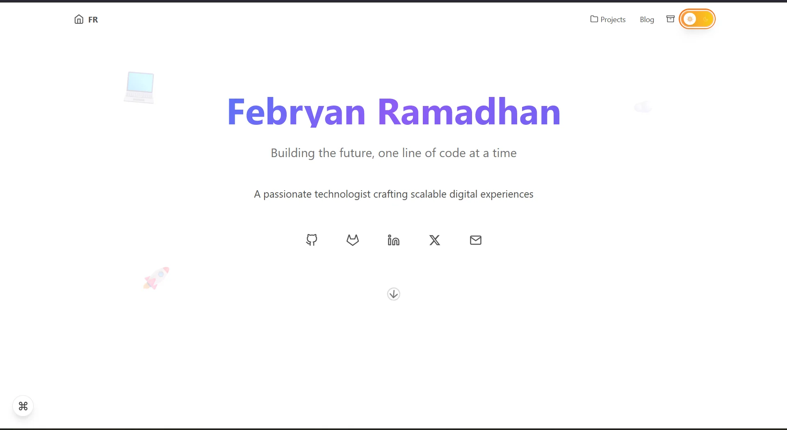

# Febryan Portfolio

Personal portfolio and technical blog of **Febryan Ramadhan** — cloud, DevOps and web development notes, mostly in Bahasa Indonesia.

🌐 **Live:** [febryan.web.id](https://febryan.web.id) · Hosted on **Cloudflare Pages**



**Stack:** Astro 5 (static output) · React 18 islands · Tailwind CSS 3 · MDX · Shiki (via rehype-pretty-code) · Pagefind · Satori

---

## Quick start

Requires **Node.js 20.3+** (the repo pins **24** in `.nvmrc`).

```bash
nvm use            # picks Node 24 from .nvmrc
npm install
npm run dev        # http://localhost:4321
```

| Command | What it does |
| --- | --- |
| `npm run dev` | Dev server with hot reload |
| `npm run check` | Type-check `.astro`/`.ts`/`.tsx` (`astro check`) |
| `npm run build` | `astro check` → `astro build` → Pagefind search index, output in `dist/` |
| `npm run preview` | Serve `dist/` locally — use this to test **search** (the index only exists after a build) |
| `npm run validate-sitemap` | Sanity-check the generated sitemap |
| `npm run compress-images` | Compress images in `public/images` |

---

## Deployment (Cloudflare Pages)

The site deploys through Cloudflare Pages' **Git integration** — there is nothing to upload by hand.

### Everyday flow

```bash
git checkout -b my-change        # work on a branch
# …edit, then check locally:
npm run build && npm run preview
git push -u origin my-change     # → Cloudflare builds a *preview* deployment
```

1. Every pushed branch gets a **preview URL** (`<branch>.<project>.pages.dev`). Find it in the Cloudflare dashboard → *Workers & Pages* → project → *Deployments*, or in the GitHub commit/PR checks.
2. When the preview looks good, merge into the **production branch** (`master`). Cloudflare rebuilds and publishes to `febryan.web.id` automatically.
3. Something wrong in production? In *Deployments*, open an earlier deployment → **Rollback**.

### Project build settings

Set once in *Settings → Builds & deployments*. Check them if a deploy fails:

| Setting | Value |
| --- | --- |
| Production branch | `master` |
| Framework preset | Astro |
| Build command | `npm run build` — must be this script, not plain `astro build`, or the search index is skipped |
| Build output directory | `dist` |
| Node.js version | Read from `.nvmrc` (24). Alternatively set the `NODE_VERSION` environment variable |

No environment variables or secrets are required.

### What Cloudflare picks up from the repo

- `public/_headers` — security headers and long-term caching for static assets.
- `dist/404.html` — served automatically for unknown URLs.
- `/tags/<tag>` → `/blog/tags/<tag>` redirects are generated as static pages by Astro (`redirects` in `astro.config.mjs`).

> `netlify.toml` and the `deploy` script (GitHub Pages via `gh-pages`) are left over from earlier hosting and are not used by Cloudflare.

---

## Project structure

```
src/
├── components/      # Astro (static) and React (interactive island) components
├── config/
│   └── components.ts  # ⭐ Site content & feature toggles: SEO, hero, projects, skills, nav…
├── content/
│   ├── config.ts      # Frontmatter schemas (posts, series)
│   ├── posts/         # Blog posts (.mdx). Files starting with _ are templates, never published
│   └── series/        # One JSON file per series (file name = series slug)
├── layouts/
│   └── Layout.astro   # <head>, theme bootstrap, Header/Footer, search, shortcuts
├── lib/               # Shared helpers: posts, theme, date format, OG image, search event
├── pages/             # Routes (blog, series, tags, archive, rss.xml, sitemap, og/*.png)
├── plugins/           # Custom rehype plugins
├── styles/            # base / prose (article + code blocks) / components / animations
├── types/             # Shared TypeScript types
└── utils/             # SEO, sitemap, series and page-toggle helpers
public/                # Static files copied as-is (images, favicons, _headers, robots.txt)
```

Most day-to-day edits (texts, projects, skills, social links, enabling/disabling pages and homepage sections) happen in **`src/config/components.ts`** — no component changes needed.

---

## Writing content

### New post

Copy `src/content/posts/_template.mdx` (or `_series-template.mdx`) to `src/content/posts/<slug>.mdx`. The file name becomes the URL: `/blog/<slug>`.

```yaml
---
title: "Judul Artikel"
date: 2026-01-15
updated: 2026-02-01          # optional
summary: "Shown on cards, in search results and as meta description."
tags: ["linux", "networking"]
category: "System Administration"
thumbnail: "/images/blog/my-post-thumb.webp"   # optional, cover image on the post & cards
draft: false                 # true = not built at all
hidden: false                # true = built (reachable by URL) but not listed anywhere
series:                      # optional
  name: "Deep Dive Linux & Networking: The Real Engineering Path"
  slug: "deep-dive-linux-networking-the-real-engineering-path"
  part: 6
openGraph:
  image: "/images/custom-share.png"  # optional, overrides the generated share image
---
```

- **Social share image** — a 1200×630 card (title, series, tags, date) is generated for every post at `/og/<slug>.png`. Set `openGraph.image` only if you want a custom one.
- **Images** — put files in `public/images/blog/` and reference them as `/images/blog/...`. They are lazy-loaded and open in a lightbox on click. Run `npm run compress-images` for large screenshots.
- **Series** — the `series.slug` must match a JSON file in `src/content/series/`. Create that file first for a new series.

### Code blocks

Highlighting follows the light/dark theme automatically.

````md
```bash title="install.sh" showLineNumbers {2-3} /sudo/
apt update
sudo apt install -y nginx
sudo systemctl enable --now nginx
```
````

- `title="…"` adds a file-name header
- `showLineNumbers` adds line numbers
- `{2-3}` highlights lines
- `/word/` highlights a word

A copy button is added to every block.

---

## Features at a glance

- **Light/dark theme:** follows the OS setting until the visitor picks one; no flash on load.
- **Blog filters:** tag, series and text filters on `/blog`, kept in the URL (e.g. `/blog?tag=linux`) so a filtered view can be shared.
- **Full-text search:** <kbd>Ctrl</kbd>/<kbd>⌘</kbd>+<kbd>K</kbd> anywhere, or the 🔍 button. Runs on a static Pagefind index built at deploy time.
- **Article pages:** table of contents, reading progress, series navigation, related posts, share buttons, Giscus comments (GitHub Discussions).
- **Keyboard shortcuts:** press <kbd>?</kbd> to see them all. <kbd>t</kbd> toggles the theme and <kbd>←</kbd>/<kbd>→</kbd> moves to the previous/next post.
- **SEO:**
  - canonical URLs, Open Graph/Twitter cards and JSON-LD
  - RSS (`/rss.xml`) and sitemap (`/sitemap-index.xml`)
  - the homepage is server-rendered, so crawlers see its full content
- **Performance:**
  - static HTML, with React only where interaction is needed
  - pages are prefetched on link hover
  - no continuous animations while the page is idle

---

## Troubleshooting

| Problem | Fix |
| --- | --- |
| Search says *"Search index not found"* | Expected in `npm run dev`. Use `npm run build && npm run preview` |
| Build fails on `astro check` | Run `npm run check` locally. It prints the file and line |
| Theme looks stuck | Remove the `darkMode` key from the browser's Local Storage |
| Cloudflare build uses an old Node | Make sure `.nvmrc` is committed, or set `NODE_VERSION` in the Pages project settings |
| `npm warn install-scripts …` after upgrading packages | npm 11 asks to approve install scripts per version: `npm install-scripts approve esbuild sharp` |

---

## Author

**Febryan Ramadhan**, Cloud Engineer based in Bogor, Indonesia
[Website](https://febryan.web.id) · [GitHub](https://github.com/Pepryan) · [LinkedIn](https://linkedin.com/in/febryanramadhan) · [X](https://x.com/pepryan) · [Email](mailto:febryanramadhan@gmail.com)
